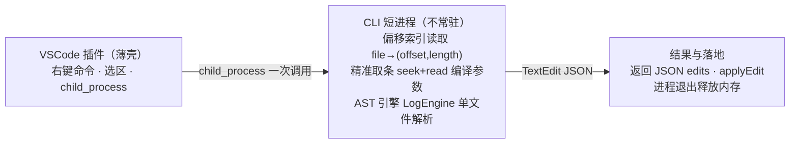

# logcommenter 产品技术规划文档

> **本文目的**：评审 logcommenter 从"单向注释日志"升级为"注入 + 注释双向日志工具"的产品定位与技术方案，确认关键取舍、里程碑与风险。
>
> **核心结论**：插件薄壳 + 短生命周期 CLI 进程；编译参数用偏移索引精准取条绕开 1GB；不 fork clangd、不常驻、不与 clangd 抢内存。

## 1. 背景与产品定位

### 1.1 要解决的问题

C++ 大项目调试日志数量多，手写与删除低效、易漏。现有 logcommenter 已实现"按标记字符串（如 `pengtest`）自动注释日志"，但仍是单向：只能删，不能加。

缺失的关键能力是**加日志**：在 IDE 中选中变量或某一行，一键插入类型感知的观测日志，实现"观测"与"静音"闭环。同时，超大 monorepo 的 `compile_commands.json` 可达 1GB，任何全量扫描的方案都会卡顿；且 clangd 已常驻占用约 700MB，不宜再叠加常驻进程的内存。

### 1.2 产品定位

logcommenter 定位为基于 Clang / LibTooling 的 C++ 源码日志工具：**注入观测日志 + 注释日志**双向能力，VSCode 右键驱动，针对超大 monorepo 场景优化性能与内存。

### 1.3 规划范围与边界

本次规划落地 M1（引擎 + CLI）与 M2（VSCode 插件）；M3（分片、格式表扩展、LSP）列为可选演进。明确不做：日志采集/输出框架、远端收集、可视化看板。

## 2. 需求

### 2.1 核心功能

| 编号 | 功能 | 触发 | 期望结果 |
|---|---|---|---|
| F1 | 注入观测日志 | 选中变量或整行，右键"插入观测日志" | 在合适位置插入类型感知的日志语句，如 `std::cout << "[obs] name=" << name << std::endl;` |
| F2 | 注释日志 | 命令行按标记批量注释（沿用现有能力） | 命中标记的日志语句前插入 `// `，可逆 |
| F3 | VSCode 集成 | 右键菜单触发 | 选区 → 调用 CLI → applyEdit 增量落地，不重写整文件 |

### 2.2 非功能需求

- **性能**：右键响应 ≤ 1–2 秒；不扫描 1GB；AST 只解析当前文件。
- **资源**：短生命周期进程，不常驻额外内存，不与 clangd 抢占。
- **兼容**：LLVM 21.1.4 / Clang；Windows + Linux。
- **可靠**：类型感知（int / string / 指针 / 容器）；重复调用幂等（已注释跳过）；不破坏源文件与缩进。

## 3. 技术方案

### 3.1 总体架构

架构分三层：VSCode 插件只做薄壳（拿选区、调进程、applyEdit）；CLI 为短生命周期进程（起→解析→返回→退出）；核心 LogEngine 负责 AST 定位与观测表达式生成。编译参数按文件精准读取，AST 只解析当前源文件。



### 3.2 核心机制：编译参数精准获取

`compile_commands.json` 是磁盘文件，clangd 只是其消费者之一，可直接自读。1GB 的根源是海量重复的公共参数与绝对路径；JSON 无随机访问，但可通过**偏移索引**实现按文件精准取条：索引只存 `file → (offset, length)`，查询时 seek + read 原文件那一条并解析，O(1)，读到的即原始命令，零数据重构。

| 对比 | 每次全量解析 1GB（淘汰） | 偏移索引精准取条（采用） |
|---|---|---|
| 取一条命令 | JSON 无随机访问，取一条也要解析整个文件 | open 原文件 → seek(offset) → read(length) 那一条 |
| 内存/CPU | 构建全量对象进内存，CPU / 内存双高 | 索引只存 file → (offset,length)，几十 MB |
| 每次开销 | 每次右键都重复 → 必然卡顿 | O(1)，不再触碰 1GB |
| 可靠性 | — | 读到的即原始命令，零数据重构、零误拼 |

> 建索引 = 一次性流式扫描 1GB（只记录偏移，不构建对象，内存可忽略），SSD 约 5–30 秒；此后每次查询不再触碰 1GB。索引失效通过文件 mtime / hash 检测，构建后变了才重扫重建。

### 3.3 CLI 协议与数据接口

CLI 统一承担注入与注释两类动作，以 JSON 输出 TextEdit，供插件或命令行消费。

```bash
logcommenter --inject --file src/foo.cpp --position 42:17 --var name --compile-dir out/build/VS
```

```json
{
  "file": "src/foo.cpp",
  "edits": [
    { "range": { "start": {"line": 42, "col": 0}, "end": {"line": 42, "col": 0} },
      "text": "    std::cout << \"[obs] name=\" << name << std::endl;\n" }
  ]
}
```

**关键约束**：输出**增量 TextEdit** 而非整文件写盘，避免与编辑器 buffer 冲突。

### 3.4 AST 引擎与观测表达式

LogEngine 输入 `(file, position/var, action)`，流程：选区映射到 AST 节点 → 读取变量 `QualType` → 按观测格式表生成打印表达式 → 计算插入位置与缩进 → 返回 TextEdit。

- **类型感知**：int 直接打印，string 打印内容，指针 / 容器按格式表扩展，避免"瞎插日志"。
- **插入位置规则**：选中变量插入作用域内声明点之后；选中整行插入该行前，缩进跟随上下文。
- **幂等**：已注释或已注入的语句跳过，重复调用不叠加。

## 4. 关键技术决策

### 4.1 对象 private 访问：friend 注入方案

对象若无 `operator<<` 且需观测 private 成员，采用**注入 friend**：在类的真实定义（头文件）处注入 friend 打印函数声明，函数定义放 .cpp 且非 inline。friend 不影响类布局、虚表、符号与 ABI，跨 so 不同步重编也安全（前提是声明进头文件、定义非 inline）。

- **适用范围**：仅用户自己可改的类；第三方 / 系统头不做，回退为地址 + 类型名。
- **生效条件**：需用户显式确认——改头文件属有副作用的动作，工具不自动执行。
- **优先级**：对象有 `operator<<` 时优先直接流式打印；无则对可改类用 friend 注入，其余回退。

### 4.2 取舍依据补充

| 决策维度 | 选择 | 依据 |
|---|---|---|
| 编译参数获取 | 偏移索引精准取条（build 若可输出分片则更优，去重索引已放弃） | 不做数据重构，seek 原文件精准取条，零误拼风险 |
| 进程模型 | 短生命周期 CLI（起→解析→返回→退出）；常驻 daemon 因额外常驻内存而放弃 | 单文件解析几百 ms 可接受 |
| 语言服务 | 插件薄壳 + 自持短进程；fork clangd 维护成本高、clangd 的 LSP 只给 AST 摘要，均放弃 | clangd 继续跑自己的，不与它抢内存 |

## 5. 里程碑

| 阶段 | 交付内容 | 验收标准 |
|---|---|---|
| M1 引擎 + CLI | 抽离 LogEngine；--inject / --comment；JSON 协议；偏移索引读取与失效同步 | 命令行对样例文件注入 / 注释成功，偏移索引查询正确 |
| M2 VSCode 插件 | 右键命令；选区→CLI；applyEdit 增量合并；回退机制 | 在真实 monorepo 内右键插入 / 注释日志，响应达标 |
| M3 演进（可选） | 分片编译参数；观测格式表扩展；LSP 升级统一右键体验 | 数据与体验充分验证后评估 |

## 6. 风险与未决事项

### 6.1 主要风险与缓解

| 风险 | 影响 | 缓解 |
|---|---|---|
| 偏移索引失效 | 构建后偏移变化导致取条错误 | mtime / hash 检测，变了才重扫重建；流式扫描一次性成本可接受 |
| 单文件解析慢 | 巨型头文件下延迟超限 | 限制解析范围；必要时引入 AST 缓存；对超大文件降级提示 |
| 类型覆盖不全 | 个别类型生成不正确的打印 | 观测格式表持续补录 + 测试用例覆盖 |
| 编译参数缺失 / 变更 | 解析失败或参数过期 | 降级为仅插入模板日志并提示，不中断操作 |

### 6.2 未决事项

- build 系统（Bazel / CMake / 其他）是否支持按模块输出分片 compile_commands —— 决定索引方案是否降级为兜底。
- 标记字符串策略（默认 `pengtest`）是否需要配置化。
- 观测日志的插入格式规范与可配置模板。
